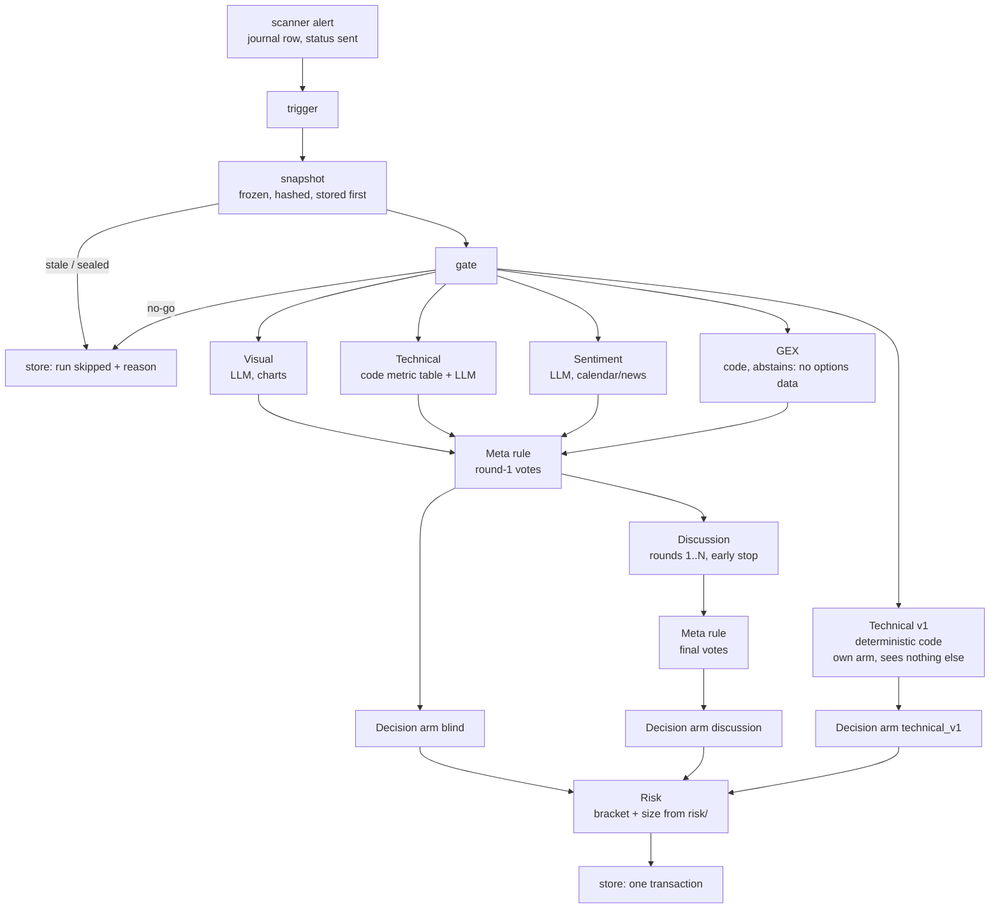

# Agents architecture (v2 target)

**Status: design, approved by the owner on 2026-10-17.** This is the flow
agreed with the owner that day, and the contract for jobs 2–5 (§11).
- Choices made while writing it are logged in the root `DECISIONS.md`,
  section `feat/agents-architecture` (AA1–AA16).
- The owner confirmed AA2, AA5/AA6 (with every refused vote change logged
  with its reason, §5.3) and AA11.
- The config gives each agent its own model, effort and `max_tokens` for
  round 1 and for the discussion (§6.1).
- Open questions are in §12.

This document replaces nothing that exists. It builds on:
- the skeleton (`agents/DESIGN.md`, `agents/README.md`): snapshot, graph,
  store, the abstain-on-failure rule;
- the Technical agent design (`docs/AGENTS_TECHNICAL_DESIGN.md`): agents v1,
  the deterministic benchmark arm;
- the LLM scanner design draft (`docs/AGENT_LLM_SCANNER_DESIGN.md`, PR #16):
  the frozen-model, cache-only-rerun and epoch rules, reused here.

The prompt author's view of the same contract is `docs/PROMPT_GUIDE.md`.

## 1. Ownership

The owner writes every agent prompt and decides how the agents behave.
Infrastructure (code built by Claude) carries the inputs to the agents and
their answers back, checks them, and stores everything. It never supplies
behaviour of its own.

| Owner-owned (never written or edited by Claude) | Infrastructure (built by Claude, reviewed by the owner) |
|---|---|
| Prompt content: `agents/prompts/visual.md`, `technical.md`, `sentiment.md`, `gex.md`, `discussion.md` | The loader, the front-matter and section parser, placeholder rendering, and the prompt templates' **skeleton** (front-matter keys, section markers, placeholder names, no instructions) |
| `agents.toml` values: models, effort, `max_tokens`, discussion rounds, the Meta rule, budget, risk parameters | The config schema and its validation, and `agents.example.toml` (a template with placeholders and comments, never the owner's values) |
| The choice of Meta rule (a name in config) | The Meta rule implementations as pluggable code, each named and versioned (§5.6) |
| What each agent sees, through which placeholders a prompt uses | Which placeholders exist and what they render (§4, `PROMPT_GUIDE.md` §3) |
| PREREG content and the freeze | The epoch id, the check that a live run matches the PREREG's epoch (§8) |

**No default behaviour.** A missing or invalid prompt, or a missing or
invalid config entry for an agent, makes **that agent abstain** with a reason
that names the file and the problem. There is never a fallback prompt, a
built-in default model, or a default Meta rule. The exceptions are the
values the owner has fixed as defaults: discussion rounds default to 2, and
early stop is on.

## 2. The flow



The same flow as text:

```
alert -> trigger -> snapshot -(stale)-------------------------------> store (skipped)
                       |
                      gate -(no-go)----------------------------------> store (skipped)
                       |  fan-out, one superstep, blind
     visual | technical | sentiment | gex        technical_v1 (benchmark)
                       |  fan-in                         |
                   meta(rule) -> Decision "blind"        |
                       |                                 |
              discussion round 1 .. N  (stop early if no vote changes)
                       |                                 |
                   meta(rule) -> Decision "discussion"   Decision "technical_v1"
                       |                                 |
                     risk (all three decisions) ---------+
                       |
                     store
```

**Blindness in round 1 holds by construction.** A round-1 agent receives a
copy of the snapshot and nothing else, as `voters/base.py` already enforces.
The round-1 templates have no placeholder that could render another
agent's vote (§4.2).

**The Technical v1 agent stays its own arm.** It votes on the same snapshot
in the same run. Its vote isn't shown to any other agent, it doesn't take
part in the discussion, and the Meta rule never counts it. Its decision is
its vote, as agents v1 scores it (`AGENTS_TECHNICAL_DESIGN.md` §1). This
makes it a benchmark on exactly the same alerts.

## 3. Graph state and nodes

The run graph keeps the existing skeleton (`agents/graph.py`). The changes:
- Round 1 is the four agents above, plus `technical_v1` as a separate branch.
- `aggregator` becomes `meta`, which runs one configured rule.
- The bull/bear `debate` subgraph is replaced by `discussion` (job 4).
- `risk` fills the bracket from `risk/`.

```python
class RunState(TypedDict, total=False):
    run_id: str
    epoch_id: str                         # §8; set at build time, the same for every run of a graph
    event: TriggerEvent
    as_of: datetime
    status: Literal["running", "skipped", "done"]
    skip_reason: str | None
    snap: Snapshot
    votes: Annotated[dict[str, Vote], merge_disjoint]          # round 1, by agent
    benchmark: Vote                                            # technical_v1
    discussion: DiscussionResult
    decisions: Annotated[dict[str, Decision], merge_disjoint]  # blind, discussion, technical_v1 (before risk)
    final_decisions: dict[str, Decision]                       # after risk
```

Only agent failures are absorbed (as abstains). A failure in the snapshot,
gate, Meta, risk or store node raises out of `run_once`, crash-only, as today.

## 4. Inputs

### 4.1 The frozen snapshot (schema version 3)

Built once per alert, hashed, and stored **before any agent runs** (the
existing `agents/snapshot.py` rules: `as_of = floor(t, 1 min)`,
`bars_before(..., known_by=t)` in live mode, the seal in replay mode). New
fields relative to version 2:

| Field | Content | Built by |
|---|---|---|
| `alert` | the Telegram facts only: `alert_id`, `alert_ts`, `session`, `level_types`, `level_price`, `price_at_alert`, `confluence_count` | the trigger (scanner journal row) |
| `trigger_levels` | ids of the levels the alert touched | the shared level library (`LevelSource`, agents v1 design §2) |
| `levels` | every level active at `as_of`: `id`, `type`, `value`, `active_from`, `touched` | same |
| `features` | σ and the vol state: `sigma_px_60`, `sigma_px_240`, `sigma_ret_60`, `sigma_ret_240`, `crosses_close_60`, `crosses_close_240`, `L`, `S_hd`, `T`, `L_tercile`, `sigma_model`, `sigma_model_sha256` | `vol_block` with the pinned HAR model |
| `metrics` | the Technical metric table (§4.3) | `agents/technical/metrics.py` (job 5) |
| `events` | calendar events in [as_of − 6 h, as_of + 24 h]; actual values only if released before `as_of` | a point-in-time calendar store (not built; empty until it exists) |
| `charts` | `(tf, sha256, width, height)` for the 15m, 1h and 4h PNGs | the chart renderer, from the snapshot's bars only |

- The snapshot hash covers every field above, including each chart's
  SHA-256. The PNGs are stored content-addressed next to the agent store.
- `experiment_id` is stored on the snapshot and never rendered into any
  prompt (D1 of the skeleton).
- The trigger payload (the full journal row) is stored with the run and is
  never shown to agents. They see `alert` only.

### 4.2 What each agent receives

| Agent | Kind | Receives | Model call |
|---|---|---|---|
| Visual | LLM | a copy of the snapshot. Its prompt decides what is rendered; the charts are attached as images where the template puts `{{charts}}` | yes |
| Technical | code + LLM | the same. Code builds `metrics` in the snapshot; the LLM interprets it through `{{metrics_table}}` | yes |
| Sentiment | LLM | the same. Typically `{{events_json}}` and `{{alert_json}}` | yes |
| GEX | code | the snapshot. **Abstains** with `no options data source` until an options/GEX feed exists (§12) | no |
| Technical v1 | code | the snapshot (agents v1 contract) | no |

The prompt author picks the inputs, by choosing placeholders. Infrastructure
decides what each placeholder renders, and that is the same for every agent
(`PROMPT_GUIDE.md` §3). Discussion placeholders (`{{other_votes_json}}`
etc.) exist only in `discussion.md`. A round-1 template that uses one is
invalid, so that agent abstains.

### 4.3 The Technical metric table (job 5)

One table, computed in code from complete candles only, shared by the
Technical-LLM (as `{{metrics_table}}`) and by the Technical v1 agent (as
inputs to its rules). Names are fixed here so prompts can reference them;
units are part of the name's definition.

| Name | Timeframes | Definition | Unit |
|---|---|---|---|
| `atr14_<tf>` | 15m, 1h, 4h | ATR(14), Wilder smoothing | price ($) |
| `atr14_<tf>_sigma` | 15m, 1h, 4h | `atr14_<tf> / sigma_px_60` | σ units |
| `rsi14_<tf>` | 15m, 1h, 4h | RSI(14), Wilder smoothing | 0–100 |
| `ema_spread_<tf>` | 15m, 1h, 4h | (EMA9 − EMA21) / `sigma_px_60` | σ units |
| `sigma_px_60`, `sigma_px_240` | — | HAR σ of the price change over 60 / 240 min | price ($) |
| `L`, `S_hd`, `T` | — | the VolBlock state (level, half-day shape, trend) | as `vol_block` |
| `dist_sigma_<level_id>` | — | (last complete 1m close − level value) / `sigma_px_240`, signed | σ units |
| `volume`, `vwap` | — | **unavailable**: the bars are a CFD midpoint with no volume. Present in the table with `available = false` until a futures-bars source exists | — |

Each row is `(name, value | null, unit, available, reason)`. An unavailable
or uncomputable metric (too few complete candles, NaN) has `value = null`,
`available = false` and a reason. It is never imputed (agents v1 fix 4).

## 5. Node contracts

All models are pydantic v2, frozen, `extra="forbid"`, NaN and inf refused,
like the existing schemas.

### 5.1 Round-1 agent

```python
class VoteAgent(Protocol):            # unchanged
    def vote(self, snapshot: Snapshot) -> Vote | dict | None: ...
```

An LLM agent is a `VoteAgent` built from three things: its prompt file, its
config section, and an `LLMClient` (job 3). Its `vote()`:
1. renders the prompt from the snapshot (missing or invalid prompt or config
   → abstain);
2. sends the request (§6);
3. parses the structured output;
4. checks the bounds and every evidence ref in code;
5. returns a `Vote`.

`safe_vote` (unchanged) turns any exception, timeout or invalid output into
an abstain with a reason.

**What the model returns** (the structured-output schema; the same for every
LLM agent and round):

```json
{
  "direction": "long | short | none",
  "confidence": 0.0,
  "reason": "<= 600 chars",
  "evidence": [{"ref": "<evidence ref>", "claim": "<= 200 chars"}]
}
```

- `evidence` holds 0–6 items in round 1.
- A `long` or `short` vote needs at least one evidence ref that resolves;
  otherwise the agent abstains with `invalid: direction without evidence`.
- The model never sets `abstain`. An abstain means the infrastructure could
  not get a valid vote (failure, refusal, timeout, invalid output), so it is
  stored apart from a `none` vote, which is a choice.

**Vote, version 2** (extends the existing `Vote`):

```python
class Evidence(_Frozen):
    ref: str
    claim: str = Field(max_length=200)
    valid: bool | None = None            # set by code (check_ref), never by the model
    invalid_reason: str | None = None

class RejectedChange(_Frozen):           # a discussion vote that the change rule refused (§5.3)
    direction: Literal["long", "short", "none"]
    confidence: float = Field(ge=0, le=1)
    reason: str = Field(max_length=600)
    evidence: tuple[Evidence, ...] = ()

class Vote(_ModelMeta):                   # model_id, prompt_hash, tokens_in/out, latency_ms
    agent: str
    round: int = Field(ge=1)              # 1 = blind; 2.. = discussion round 1..
    direction: Literal["long", "short", "none"]
    confidence: float = Field(ge=0, le=1)
    reason: str = Field(max_length=600)
    evidence: tuple[Evidence, ...] = ()
    abstain: bool = False
    abstain_reason: str | None = None
    changed: bool = False                 # discussion only: differs from this agent's previous vote
    change_rejected: str | None = None    # discussion only: why a proposed change was refused (§5.3)
    rejected_proposal: RejectedChange | None = None   # discussion only: the refused vote, as data
    call_id: str | None = None            # -> llm_calls; None for code agents
```

### 5.2 Discussion

Inputs: the snapshot, the round-1 votes, and `discussion.rounds` (N) from
config. Nothing else from the run state enters the subgraph.

```python
class DiscussionView(_Frozen):
    agent: str
    round: int                            # 1..N within the discussion
    max_rounds: int
    snapshot: Snapshot
    own_previous: Vote                    # content only
    others: tuple[Vote, ...]              # every other agent's latest vote, content only

class DiscussionResult(_Frozen):
    snapshot_hash: str
    max_rounds: int
    rounds_run: int                       # 1..max_rounds
    stopped_early: bool
    votes: tuple[Vote, ...]               # every discussion vote, ordered by (round, agent)
    final: dict[str, Vote]                # each agent's last vote (round-1 vote if it never spoke)
```

- **Who speaks:** each LLM agent whose round-1 vote didn't abstain. Code
  agents (GEX) and abstained agents keep their round-1 vote, and the others
  see it as it is.
- **Simultaneous rounds.** In discussion round r, every agent sees the
  others' votes from round r − 1 (round 1 of the discussion sees the
  round-1 votes). It doesn't see what others say in the same round.
- **Content only.** Others' votes are shown without model ids, prompt hashes,
  tokens or latencies (the existing `content_only`). Evidence validity flags
  are shown, so an agent knows which of the others' refs resolved.
- **Early stop:** after a round in which no agent's vote changed (an accepted
  change, §5.3), the discussion ends. `rounds_run` and `stopped_early` are
  stored.
- The Meta rule runs on `final`, which gives the `discussion` decision.

### 5.3 The vote-change rule

A discussion vote **changes** if its direction or its confidence differs
from the agent's previous vote.
- A change is **accepted** only if the new vote carries at least one evidence
  ref that resolves in the snapshot and wasn't already in the agent's
  previous vote. A `vote:<agent>:<round>` ref (citing another agent's
  argument) is allowed, but it never counts as that evidence on its own: an
  agent can't change its mind only because another agent said so.
- A proposed change without such a ref is **rejected**. The agent's previous
  vote is carried forward unchanged as this round's vote, with
  `change_rejected` set to the reason. The rejected proposal itself is kept
  in `llm_calls` (the raw response).
- **Every refused change is logged with its reason** (owner, 2026-10-17):
  - the carried-forward vote row has `change_rejected` set to the reason
    (`no new snapshot ref`, `only vote: refs`, `call failed: <reason>`,
    `invalid: <reason>`);
  - `rejected_proposal` holds the refused direction, confidence, reason and
    evidence, with validity flags, as structured data and not only in the raw
    response;
  - every run report counts the refused changes by reason, per agent.
- No change, and a restated vote, need no new evidence.
- An invalid response or a failed call in a discussion round carries the
  previous vote forward with `change_rejected = "call failed: <reason>"`.
  It's never an abstain mid-discussion, so one failed round can't erase a
  valid round-1 vote. Logged as AA6.

### 5.4 The discussion request

Each discussion turn is one stateless request whose prefix is byte-identical
to that agent's round-1 request:

```
system     = the agent's system section (as in round 1)
messages   = [ user: the agent's round-1 user content (text + images, same bytes),
               user: discussion.md's user section, rendered for this agent and round ]
```

- No assistant turns are replayed. The agent's own earlier answer reaches it
  as data, through `{{own_previous_vote_json}}`. This avoids the thinking-block
  replay rules of the current models, and the request stays a pure function
  of (snapshot, votes).
- The shared prefix makes **prompt caching** worthwhile within a run.
  Discussion rounds follow round 1 within minutes, inside the 5-minute cache
  TTL (§9). Across alerts, hours apart, caching doesn't help.

### 5.5 Meta

```python
class MetaRule(Protocol):
    name: str                             # e.g. "quorum_v0"
    version: str
    def decide(self, votes: Mapping[str, Vote]) -> tuple[Direction, str]: ...   # (direction, reason)
```

- `meta.rule` in `agents.toml` names one rule. A missing or unknown name makes
  Meta **abstain**: decision direction `none`, reason
  `meta: no rule configured` / `meta: unknown rule <name>`. There is never a
  default rule.
- Rules shipped as code (job 4), unchanged in behaviour from their specs:
  - `quorum_v0`: the current `aggregator_v0` (≥ 2 agreeing non-abstaining
    votes, else `none`);
  - `fixed_meta_v1`: the bug-fixed `meta_decision` of the Technical design
    §1 (direction = argmax of per-direction scores, `none` on a tie, the
    agreement tiers as exact fractions, a minimum number of participants).
- The same rule, with the same parameters, decides both arms (`blind` on the
  round-1 votes, `discussion` on the final votes), so the two arms differ
  only by the discussion.
- `technical_v1` is never an input to Meta.

### 5.6 Risk

`apply_risk(decision, snapshot, cfg) -> Decision`, plain code, the same for
all three arms:
- `entry` = the snapshot's last complete 1m close;
- `sl` / `tp` from `risk.bracket` with the owner's `risk.k` and
  `features.sigma_px_240`;
- `size` from `risk.sizing`.
- A `none` decision passes through with the bracket null.
- A missing σ leaves the bracket null, with the reason in the decision. It
  doesn't change the direction.

### 5.7 Store

One transaction per run (the existing `save_run`); the snapshot is written
first. Agent store **migrations 3–5**, one per job, add the following.
Migration 3 is the epoch stamps (job 2), 4 the LLM tables (job 3), and 5
the discussion columns and arms (job 4):

| Table / column | Content |
|---|---|
| `runs.epoch_id` | §8 |
| `votes`: `evidence_json`, `changed`, `change_rejected`, `rejected_proposal_json`, `call_id`, `epoch_id`, plus the `model`, `effort` and `max_tokens` that produced it | every vote of every round (the PK `(run_id, round, agent)` already allows rounds) |
| `discussions` | one row per run: `max_rounds`, `rounds_run`, `stopped_early` |
| `decisions.arm` | adds `discussion` and `technical_v1`. `blind` keeps its name: it is the decision after round 1. `debate` stays allowed for old rows only. Also adds `meta_rule`, `meta_version` and `epoch_id` |
| `llm_calls` | one row per attempt: `call_id`, `run_id`, `agent`, `round`, `model` (requested and returned), `effort`, `max_tokens`, `prompt_hash`, `prompt_file_sha256`, `config_sha256`, `request_id`, `stop_reason`, `refusal_category`, usage (input, output, cache read, cache write), `latency_ms`, `attempt`, `error`, `cached` (served from `llm_responses`), cost in USD at the list price, `created_ts` |
| `llm_responses` | the response cache: `prompt_hash` PK, `model`, `request_id`, `response_json`, `usage_json`, `stop_reason`, `created_ts` (agents v1 design §4) |

All tables stay append-only (the existing triggers).

## 6. The LLM call (job 3)

- **SDK:** the official `anthropic` Python SDK, pinned in the lock.
- **Model:** an exact id from `agents.toml`, **per agent and per round
  type** (round 1 vs discussion, §6.1), e.g. `claude-opus-5-5` or
  `claude-sonnet-5-5`, with no alias and no date suffix. A response whose
  `model` differs from the requested id → abstain `model_mismatch`.
- **Request:** `system`, one `user` message (text and image blocks),
  `max_tokens` and `output_config` = `{effort, format: the vote JSON schema}`
  (structured outputs).
  - **No `temperature`, `top_p` or `top_k`:** current models reject
    non-default sampling parameters with a 400.
  - Thinking: Opus 5.5 can't disable it, so `effort` is the only depth control.
    Its default is `medium` on Opus 5.5 and `high` on Sonnet 5.5, so the
    config sets it explicitly.
  - No tools, no web search.
- **Refusal fallbacks off.** The API offers a server-side `fallbacks`
  parameter that re-runs a refused request on another model. It is
  deliberately not used: it would switch the model silently inside an epoch.
  `stop_reason == "refusal"` → abstain `refusal:<category>`.
- **Other stop reasons:** `max_tokens` → abstain `truncated`. A parse,
  bounds or ref failure → abstain `invalid:<reason>`, with the raw response
  kept in `llm_calls`.
- **Timeouts and retries:** a per-attempt timeout and a bounded retry count
  from config (the SDK's own retry policy: 408, 409, 429, 5xx and connection
  errors). An abstain `api_error` after the last attempt. The round-1 node
  timeout (`node_timeout_s`) bounds the whole agent call.
- **Logged per attempt:** `request_id` (`response._request_id`), usage,
  stop reason, latency.
- **Response cache and modes:** `llm.mode = live | rerun`.
  - **live:** call the model, store the response in `llm_responses` before
    using it.
  - **rerun:** cache only. A miss is an abstain `cache_miss`, never a call,
    so a rerun is byte-identical.
  - `prompt_hash` = SHA-256 of the canonical request body (model, system,
    messages including image hashes, `max_tokens`, `output_config`).
- **Budget and kill switch:**
  - `budget.max_calls_per_day` counts attempts per UTC day, cache hits
    excluded. Past it → abstain `budget`.
  - The kill switch is a file (`budget.kill_switch_path`) or the env var
    `AGENTS_LLM_KILL=1`. While it is present, every LLM agent abstains
    `kill_switch` and no call is made. Code agents and Technical v1 still
    vote.
- **Tests** use a `FakeLLMClient` with scripted responses. No unit test calls
  the API.

### 6.1 Per-agent, per-round call settings (`agents.toml`)

Every LLM agent has two call blocks, one for round 1 and one for the
discussion. The owner sets every value; there is no default model, effort or
`max_tokens` anywhere in code.

```toml
[agents.visual.round1]          # one block per LLM agent: visual, technical, sentiment
model      = "<model id>"       # exact id, no alias
effort     = "<low|medium|high|xhigh|max>"
max_tokens = <int>

[agents.visual.discussion]      # may differ from round1
model      = "<model id>"
effort     = "<...>"
max_tokens = <int>
```

- **Missing or invalid `round1` block:** that agent abstains in round 1
  (`config_invalid: agents.visual.round1.<key>: <problem>`).
- **Missing or invalid `discussion` block:** the agent doesn't speak. Its
  round-1 vote is carried forward each round with `change_rejected =
  "config_invalid: agents.visual.discussion…"` (AA6).
- **A different model in the discussion** is allowed. The discussion request
  then can't read round 1's prompt cache, because caches are per model, so
  its input is billed in full (§9).
- **Recorded:** the settings actually used are stored on every vote and
  `llm_calls` row, and all of them enter the epoch (§8).
- The exact schema, its validation and `agents.example.toml` are job 2.

## 7. What is logged per round

| When | Rows |
|---|---|
| Snapshot | `snapshots` (content JSON, hash, chart hashes), before any agent runs |
| Round 1 | one `votes` row per agent (round 1) with evidence and validity flags; one `llm_calls` row per attempt for each LLM agent; the `technical_v1` vote |
| After round 1 | the `blind` decision: Meta rule name and version, its reason, the epoch id |
| Each discussion round r | one `votes` row per speaking agent (round r + 1) with `changed` / `change_rejected`; one `llm_calls` row per attempt |
| After the discussion | the `discussions` row (`rounds_run`, `stopped_early`) and the `discussion` decision |
| Risk | the bracket and size on each decision, or the reason it's null |
| Run | `runs`: trigger, status, `config_json` and `config_sha256`, the prompt file SHA-256s, `epoch_id`, the code version |

Decisions are stored twice for every alert, `blind` and `discussion`, plus
`technical_v1`. A run that is skipped (stale, gate) stores the run row and
the reason only.

## 8. Epochs

An **epoch** is one fixed set of everything that can change an agent's
answer. `epoch_id` = SHA-256 of the canonical JSON of:

- each prompt file's SHA-256 (the raw bytes, front-matter included), for
  every agent and `discussion.md`;
- the `agents.toml` SHA-256 after validation (canonical JSON of the parsed
  config, so formatting and comments don't count, values do);
- per agent **and per round type** (round 1, discussion): the model id,
  effort and `max_tokens`;
- the SHA-256 of the output JSON schema;
- the snapshot schema version, and the source hash of the code that builds
  inputs (snapshot builder, metric table, chart renderer and its settings,
  placeholder renderer);
- the Meta rule name and version;
- the σ model SHA-256;
- the scanner journal epoch the alerts come from.

**Rules:**
- **Any change, of any item, is a new epoch.** That includes a prompt typo,
  a config value, a model id, a renderer fix, or the scanner restarting into
  a new journal epoch. It happens automatically, because the id is a hash; no
  one has to remember to bump it.
- `epoch_id` is stored on every run, vote, decision and `llm_calls` row.
- **Results are never pooled across epochs.**
- A live evidence experiment pins one `epoch_id` in its PREREG. The runner
  refuses to store an evidence decision whose `epoch_id` differs (it is
  stored as development, flagged). A new epoch needs a PREREG addendum and a
  new `experiment_id`.
- The front-matter `version` is for humans. If a prompt's bytes change but
  its `version` doesn't, a warning is logged and stored. The epoch changes
  either way (AA10).
- `python -m agents.epoch` (job 2) prints the current epoch id and what
  differs from the last stored run.
- **The epoch is the same in any checkout.** No input holds a file path; a
  missing file enters as "not found", not as where it was looked for.

## 9. Cost per alert (estimate)

**Assumptions.** These are estimates. `count_tokens` is run on the owner's
real prompts before any freeze, and the actual cost is logged per call
(`llm_calls`).
- The owner's system prompts are ≈ 2,000 tokens each.
- The three charts are 1000 × 600 px, ≈ w·h/750 ≈ 800 tokens each.
- All LLM agents use the same model in both rounds, with `effort = medium`
  set explicitly. The owner can set a different model or effort per agent and
  per round (§6.1). A discussion model different from the round-1 model
  loses the within-run cache, so its input costs ≈ 5× the cached figure.
- Discussion: 2 rounds; the early stop ends ~half of the runs after one.

Tokens per call:

| Call | Input | Output (visible + thinking) |
|---|---:|---:|
| Visual, round 1 (system 2k, alert + levels 1.5k, 3 charts 2.4k) | ≈ 6,000 | ≈ 2,000–4,500 |
| Technical-LLM, round 1 (system 2k, metric table + levels 2.5k) | ≈ 4,500 | ≈ 2,000–4,000 |
| Sentiment, round 1 (system 2k, alert + events 2k) | ≈ 4,000 | ≈ 1,500–3,000 |
| **Round 1, three calls** | **≈ 14,500** | **≈ 5,500–11,500** |
| One discussion round, three calls: the round-1 prefix (cache read) plus ≈ 1,000 new tokens each | ≈ 14,500 cached + 3,000 new | ≈ 4,500–9,000 |

GEX, Technical v1, Meta and Risk are code: $0.

List prices per million tokens, from the Claude API reference (cached
2026-10-06):
- Opus 5.5: $4 input, $20 output, $0.20 cache read.
- Sonnet 5.5: $2 input, $10 output, $0.20 cache read.
- Haiku 5.5: $0.10 input, $0.50 output (prompts up to 100k tokens). Its
  cache-read price isn't in the reference; the estimate takes 0.1× input.
- A 5-minute cache write costs 1.25× the input price.
- Thinking is billed as output.

| Model (all LLM agents) | Round 1 | Each discussion round | **Per alert** (1–2 rounds) | Per day at 5 alerts | Per year (≈ 260 trading days) |
|---|---:|---:|---:|---:|---:|
| Claude Opus 5.5 | ≈ $0.18–0.30 | ≈ $0.10–0.20 | **≈ $0.28–0.70** | ≈ $1.40–3.50 | ≈ $360–910 |
| Claude Sonnet 5.5 | ≈ $0.09–0.15 | ≈ $0.05–0.10 | **≈ $0.14–0.35** | ≈ $0.70–1.75 | ≈ $180–455 |
| Claude Haiku 5.5 | ≈ $0.005–0.008 | ≈ $0.003–0.005 | **≈ $0.007–0.017** | ≈ $0.04–0.09 | ≈ $9–22 |

What drives these numbers:
- **Output dominates** (≈ 70–85 % of the bill), and most of the output is
  thinking. Effort is the main lever. `low` roughly halves the output share;
  measure that on the real prompts before choosing.
- **Within-run caching is the one place caching pays.** Round 1 writes each
  agent's prefix (+25 % on ≈ 14.5k tokens). Every discussion round then
  reads it at 5 % of the input price. Without caching, the discussion input
  would cost ≈ 5× more; on Opus that is +$0.055 per round.
- **Busy days** (≈ 10 alerts) double the day's figure.
- The budget cap (`budget.max_calls_per_day`) bounds a runaway. For example,
  60 attempts a day is ≈ 6 full alerts on Opus at the high end, ≈ $5.

The model and effort are the owner's choice (§12). The Batch API (50 % off)
doesn't fit: answers are needed within minutes of the alert.

## 10. Failure handling (summary)

| Failure | Result |
|---|---|
| Prompt file missing, bad front-matter, unknown placeholder, placeholder in `## system` | that agent abstains `prompt_invalid: <file>: <problem>` |
| Agent config missing or invalid (model, effort, max_tokens) | that agent abstains `config_invalid: <key>: <problem>` |
| Meta rule missing or unknown | Meta abstains: decisions `none` with the reason |
| Stale snapshot / sealed replay / no PREREG in live mode | the run is skipped with the reason (existing rules) |
| API error after retries, timeout | abstain `api_error` / `timeout` |
| `refusal`, `max_tokens` | abstain `refusal:<category>` / `truncated` |
| Invalid output, bounds, an unresolvable ref on a directional vote | abstain `invalid:<reason>`, raw response kept |
| Model mismatch | abstain `model_mismatch` |
| Rerun cache miss | abstain `cache_miss` (never a call) |
| Budget reached, kill switch on | abstain `budget` / `kill_switch` |
| Any discussion-round failure | the previous vote is carried forward, `change_rejected` set (§5.3) |

Every abstain reason is stored and counted. None of them crashes the run.

## 11. Build order (one branch and PR each, after the owner approves this document)

1. **This document and `docs/PROMPT_GUIDE.md`** (`feat/agents-architecture`).
2. **Prompt and config layer:**
   - prompt loading with front-matter (`agent`, `version`) and the
     `## system` / `## user` sections;
   - placeholder rendering;
   - config validation (`agents.toml` schema, `agents.example.toml`);
   - the SHA-256 of both recorded on every decision;
   - `epoch_id` and `python -m agents.epoch`;
   - *built:* `agents/prompting/`, `agents/owner_config.py`,
     `agents/epoch.py`, snapshot schema 3 (alert facts from the trigger;
     the other slots empty and marked unavailable), migration 3;
   - template skeletons (front-matter, section markers, placeholders, no
     instructions) for visual, technical, sentiment, gex and discussion.
3. **LLM client layer** (§6), with `FakeLLMClient`, `llm_calls` and
   `llm_responses`.
4. **The discussion subgraph** replacing bull/bear (§5.2–5.4), plus the Meta
   rules as pluggable code (§5.5).
   - The existing `bull.md` / `bear.md` are owner prompts. They are left in
     place, unused, for the owner to delete.
5. **The Technical metric table** (§4.3), shared by Technical v1 and the
   Technical-LLM.

Not in these jobs:
- the chart renderer and the calendar store (`AGENT_LLM_SCANNER_DESIGN.md`
  §13);
- the live runner on the journal;
- deployment.

Until the renderer and the calendar store exist, `{{charts}}` renders
nothing and `{{events_json}}` renders `[]`. Both are flagged in the snapshot,
and a prompt that needs them is the owner's call.

## 12. Open questions for the owner

**Answered on 2026-10-17:**
- **Q1, models and effort:** the owner sets them, per agent and per round
  (§6.1).
- **Q2, the vote-change rule:** AA5/AA6 as designed (one new snapshot ref;
  a refused change carries the previous vote forward), with every refused
  change logged with its reason (§5.3).
- **Arms:** AA2 as designed.
- **Fallbacks:** AA11 as designed.

**Still open:**
3. **Confidence-only changes.** They count as changes here, so they need
   evidence. That matters only if the chosen Meta rule uses confidence
   (`fixed_meta_v1` does, `quorum_v0` doesn't).
4. **One `discussion.md` for all agents,** or one per agent
   (`discussion_visual.md`, …)?
5. **GEX data source:** which options/GEX feed, and from when. Until then GEX
   always abstains, and it counts as an abstain in Meta.
6. **The Meta rule** for the first epoch: `quorum_v0` or `fixed_meta_v1`.
7. **The calendar** (Sentiment's main input) isn't built yet. Should
   Sentiment run on the alert facts alone until then, or be disabled (it
   abstains `disabled_in_config`)?
